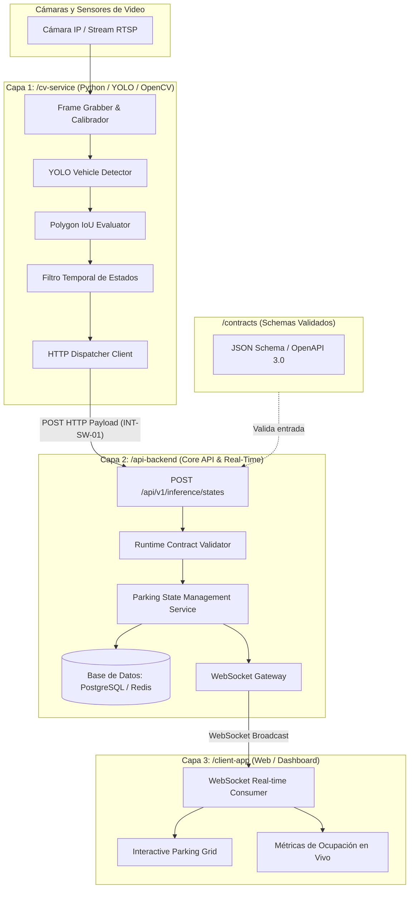

# PARK FLOW 🚗🅿️

> **Sistema Inteligente de Monitoreo y Gestión de Estacionamiento en Tiempo Real por Visión Computacional**  
> *Instituto Tecnológico de Morelia (TecNM) — Ingeniería en Sistemas Computacionales • Ingeniería de Software (ERSIS2026 III)*

[](LICENSE)
[](https://python.org)
[](https://fastapi.tiangolo.com)
[](https://react.dev)
[](#equipo-de-desarrollo-y-roles-scrumban)

---

## 📌 Descripción del Proyecto

**ParkFlow** es una solución tecnológica no invasiva diseñada para optimizar el flujo vehicular y reducir el tiempo de búsqueda de cajones en los estacionamientos del Campus 1 y Campus 2 del Instituto Tecnológico de Morelia (ITM). Mediante cámaras de seguridad fijas (RTSP) y modelos de visión por computadora (**Ultralytics YOLO** + **OpenCV**), el sistema clasifica en tiempo real el estado de cada polígono de cajón (`Libre`, `Ocupado`, `En maniobra`) tras un filtro temporal de confirmación y difunde los eventos a través de una aplicación web/PWA y pantallas informativas.

---

## 👥 Equipo de Desarrollo y Roles (Scrumban)

| Integrante | Rol | Contacto Institucional |
| :--- | :--- | :--- |
| **Haziel Ruiz Zúñiga** | Product Owner / Scrum Master & Analista | `l221213339@morelia.tecnm.mx` |
| **José Rodrigo Vargas Carrillo** | Tech Lead & Arquitecto de Software | `l23121118@morelia.tecnm.mx` |
| **Miguel Ángel Cristal Bolaños** | DevOps & QA Engineer | `l23121135@morelia.tecnm.mx` |
| **Julio Armando Martínez Equihua** | Computer Vision & Backend Developer | `l23121112@morelia.tecnm.mx` |
| **Luis Antonio Anzaldua Mendez** | Full-Stack & Frontend Developer | `l24120432@morelia.tecnm.mx` |

---

## 🏗️ Arquitectura Modular en 3 Capas Desacopladas (`RNF-05` & `INT-SW-01`)

El monorepo aplica aislamiento absoluto entre servicios (**RNF-05**). Ninguna capa importa código fuente interno de otra; toda comunicación ocurre exclusivamente mediante contratos de red (HTTP REST y WebSockets) definidos en `/contracts` como única fuente de la verdad (*Single Source of Truth*):

1. **Contratos Declarativos (`/contracts`)**:
   - `contracts/json-schema/inference-state.schema.json`: Esquema JSON Schema (Draft 2020-12) que gobierna el payload de inferencia por polígono (`Libre`, `Ocupado`, `En maniobra`, `confidence`, `iou_ratio`, `camera_id`, `timestamp`).
   - `contracts/openapi/cv-backend-spec.yaml`: Especificación OpenAPI 3.0.3 del endpoint de ingestión `POST /api/v1/inference/states`.
2. **Capa 1 — Motor de Visión Computacional (`/cv-service`)**:
   - Captura streams RTSP, ejecuta inferencia vehicular con YOLO/OpenCV, evalúa la intersección sobre unión (**IoU**) por polígono, aplica la máquina de estados temporal (`Libre` ⇄ `En maniobra` ⇄ `Ocupado`) y despacha eventos HTTP validados.
3. **Capa 2 — Servidor Orquestador y Tiempo Real (`/api-backend`)**:
   - Servicio FastAPI que valida en frontera cada petición entrante contra `inference-state.schema.json` (respondiendo `202 Accepted` en éxito, `422 Unprocessable Entity` ante estados inválidos y `400 Bad Request` ante violaciones estructurales), calcula métricas de aforo/alertas (`RF-04`) y transmite cambios vía WebSockets.
4. **Capa 3 — Aplicación Cliente y Dashboard (`/client-app`)**:
   - Frontend React/PWA suscrito en tiempo real al gateway WebSocket (`/ws/parking-states`) para visualización de disponibilidad de cajones.

### Diagrama de Componentes (`RNF-05`)



---

## 📋 Trazabilidad de Requisitos del Sistema (ERS)

| Código ERS | Categoría | Descripción | Estado / Implementación |
| :--- | :--- | :--- | :--- |
| **RNF-05** | Mantenibilidad | Arquitectura modular y desacoplada en 3 capas (`/cv-service`, `/api-backend`, `/client-app`). | Implementado en monorepo con redes Docker aisladas. |
| **INT-SW-01** | Interfaz Software | Integración CV → Backend mediante JSON Schema y OpenAPI 3.0.3 para estados `Libre`, `Ocupado`, `En maniobra`. | Implementado en `/contracts`, `/cv-service` y `/api-backend`. |
| **RF-01** | Funcional | Consulta de disponibilidad de cajones en tiempo real desde dispositivos móviles/web. | Soportado por gateway WebSocket y `/client-app`. |
| **RF-04** | Funcional | Alertas automáticas cuando la ocupación supere el 90% de capacidad. | Calculado en `ParkingStateService` (`/api-backend`). |
| **RNF-01 / RNF-07** | Rendimiento | Tiempo de respuesta web ≤ 3s, latencia de visión ≤ 5s y precisión ≥ 95% día / ≥ 90% noche. | Filtro temporal anti-oclusiones en `SlotTemporalStateMachine`. |

---

## 🚀 Despliegue Local y Ejecución

### Prerrequisitos
- **Docker** y **Docker Compose** v2+
- **Python 3.11+** (para desarrollo y pruebas locales de `/cv-service` y `/api-backend`)
- **Node.js 20+** (para desarrollo local de `/client-app`)

### 1. Levantar el entorno completo con Docker Compose
Desde la raíz del monorepo, ejecuta:

```bash
docker compose up --build
```

Servicios expuestos y redes aisladas:
- **`api-backend`**: `http://localhost:8000` (Documentación interactiva en `http://localhost:8000/docs` y salud en `http://localhost:8000/health`).
- **`client-app`**: `http://localhost:5173` (Conectado a `ws://localhost:8000/ws/parking-states` sobre la red `client-realtime-net`).
- **`cv-service`**: Conectado internamente hacia `http://api-backend:8000` sobre la red aislada `cv-ingestion-net`.

### 2. Probar manualmente el contrato `INT-SW-01`
Enviar una actualización de estados válida (`HTTP 202 Accepted`):

```bash
curl -X POST http://localhost:8000/api/v1/inference/states \
  -H "Content-Type: application/json" \
  -d '{
    "camera_id": "e6f4776b-3122-4a0b-857e-3c22db92dcb1",
    "parking_lot_id": "ITM-CAMPUS1-EST-NORTE",
    "timestamp": "2026-10-27T18:30:00Z",
    "frame_sequence": 1042,
    "polygons": [
      {
        "polygon_id": "poly-itm-001",
        "slot_name": "C-01",
        "state": "En maniobra",
        "confidence": 0.89,
        "iou_ratio": 0.38,
        "vehicle_type": "car"
      }
    ]
  }'
```

---

## ⚖️ Licencia

Este proyecto se distribuye bajo la licencia **[PolyForm Noncommercial License 1.0.0](LICENSE)**.  
Se autoriza su uso, modificación y despliegue con fines académicos, de investigación e institucionales en el **Instituto Tecnológico de Morelia (TecNM)**; queda estrictamente prohibida su explotación comercial por terceros.
