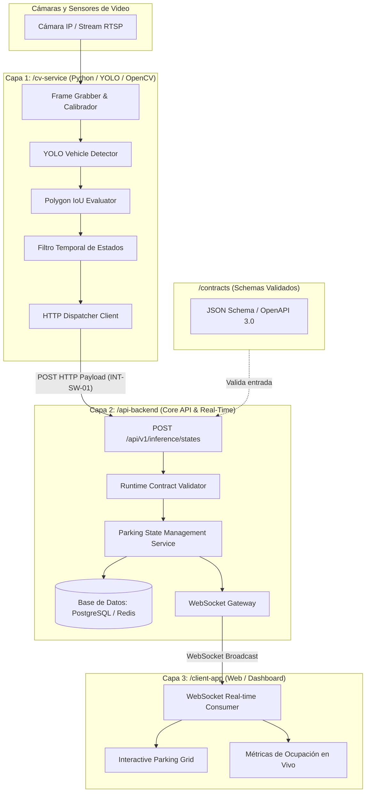

# AGENTS.md — ParkFlow Project Context & Development Guidelines

> **Proyecto**: ParkFlow — Sistema Inteligente de Gestión y Monitoreo de Estacionamiento en Tiempo Real  
> **Institución**: Instituto Tecnológico de Morelia (TecNM) • Ingeniería en Sistemas Computacionales  
> **Materia**: Ingeniería de Software (ERSIS2026 III)  
> **Product Owner / Scrum Master**: Haziel Ruiz Zúñiga (`l221213339@morelia.tecnm.mx`)  
> **Licencia del Repositorio**: [PolyForm Noncommercial License 1.0.0](https://www.google.com/search?q=LICENSE) (Producción académica y despliegue permitido; explotación comercial prohibida)
> mkdir -p contracts/json-schema contracts/openapi cv-service api-backend client-app
git checkout -b feat/RNF-05-monorepo-structure

---

## 1. Propósito y Alcance del Documento

Este archivo define el contexto operativo, los estándares arquitectónicos y las reglas de diseño para cualquier **agente de inteligencia artificial** (Cursor, GitHub Copilot, Windsurf, Claude Code, etc.) y desarrollador que colabore en el repositorio de **ParkFlow**.

Todo agente que proponga cambios, genere código o realice refactorizaciones debe cumplir estrictamente con los criterios de aceptación y la trazabilidad de requisitos del ERS (Especificación de Requisitos de Software) del proyecto.

---

## 2. Requisito Activo y Trazabilidad ERS (ERSIS2026 III)

### 2.1. Ficha del Ticket Activo
- **Prioridad**: Crítica
- **Lead Time Estimado**: 2.4 días | **Cycle Time Estimado**: 1.5 días
- **Responsable Principal**: Haziel Ruiz Zúñiga (PO / Scrum Master & Analista)
- **Descripción Técnica**: Establecer la separación estricta en 3 capas (`/cv-service`, `/api-backend`, `/client-app`) y especificar el esquema JSON de intercambio de estados (`Libre`, `Ocupado`, `En maniobra`) por polígono de estacionamiento.

### 2.2. Trazabilidad con Requisitos
| Código ERS | Categoría | Prioridad | Descripción en ERS | Implementación Técnica |
| :--- | :--- | :--- | :--- | :--- |
| **RNF-05** | Mantenibilidad | Media / Deseado | Arquitectura modular y facilidad de mantenimiento. | Separación estricta y desacoplamiento en 3 capas (`/cv-service`, `/api-backend`, `/client-app`). |
| **INT-SW-01** | Interfaz Software | Alta / Esencial | Integración con Pipeline de Visión Computacional. | API interna que recibe JSON con estados (`Libre`, `Ocupado`, `En maniobra`) por polígono desde OpenCV/YOLO. |

### 2.3. Criterios de Aceptación (Definition of Done - DoD)
- [ ] **Estructura de Directorios**: Carpetas `/cv-service`, `/api-backend` y `/client-app` creadas, aisladas a nivel de dependencias y documentadas.
- [ ] **Contrato OpenAPI & JSON Schema**: Especificación formal y validada para los tres estados permitidos (`Libre`, `Ocupado`, `En maniobra`).
- [ ] **Diagrama de Componentes**: Diagrama formal RNF-05 documentado en formato Mermaid.
- [ ] **Aprobación de Arquitectura**: Revisión y visto bueno por Product Owner (`Haziel Ruiz Zúñiga`) y Tech Lead.

---

## 3. Arquitectura del Monorepo en 3 Capas Desacopladas (RNF-05)

El monorepo está estructurado para que ningún servicio dependa del código fuente interno de otro. La comunicación se realiza **únicamente mediante contratos de red** (HTTP/REST y WebSockets) definidos en `/contracts`.

```text
parkflow/
├── .github/
│   ├── workflows/             # Pipelines CI/CD independientes por capa
│   └── pull_request_template.md
├── contracts/                 # Fuente de la verdad de los esquemas (Single Source of Truth)
│   ├── json-schema/
│   │   └── inference-state.schema.json
│   └── openapi/
│       └── cv-backend-spec.yaml
├── cv-service/                # Capa 1: Pipeline de Visión Computacional (YOLO + OpenCV)
│   ├── src/
│   │   ├── capture/           # Ingestión de RTSP/video
│   │   ├── detector/          # Inferencia con YOLO (detección vehicular)
│   │   ├── polygon_mapper/    # Intersección IoU de vehículos con polígonos de cajón
│   │   ├── state_machine/     # Lógica temporal (Libre, En maniobra, Ocupado)
│   │   └── client/            # Emisor HTTP hacia /api-backend
│   ├── tests/
│   ├── Dockerfile
│   ├── requirements.txt
│   └── README.md
├── api-backend/               # Capa 2: Orquestador de Negocio y Persistencia
│   ├── src/
│   │   ├── api/               # Endpoints REST e ingestión de inferencia
│   │   ├── websocket/         # Gateway de broadcast hacia clientes
│   │   ├── services/          # Lógica de cálculo de ocupación y alertas
│   │   ├── models/            # Entidades de Base de Datos
│   │   └── validators/        # Validación en runtime con JSON Schema
│   ├── tests/
│   ├── Dockerfile
│   ├── package.json (o pyproject.toml / go.mod)
│   └── README.md
├── client-app/                # Capa 3: Aplicación Cliente (Dashboard y App de Usuario)
│   ├── src/
│   │   ├── components/        # Layout de estacionamiento y visor de cajones
│   │   ├── hooks/             # Suscripción a WebSockets en tiempo real
│   │   └── views/             # Vistas de operador y visualización de disponibilidad
│   ├── Dockerfile
│   ├── package.json
│   └── README.md
├── docker-compose.yml         # Orquestación de entorno de desarrollo local
├── AGENTS.md                  # Este archivo de instrucciones para agentes
├── LICENSE                    # PolyForm Noncommercial 1.0.0
└── README.md                  # Visión general del proyecto y guía de inicio
```

---

## 4. Diagrama de Componentes del Sistema (RNF-05)



---

## 5. Especificación de la Interfaz Software (INT-SW-01)

### 5.1. Máquina de Estados del Cajón
Cada polígono representa un espacio de estacionamiento físicamente delimitado y transita entre 3 estados discretos:

1. **`Libre`**: Espacio desocupado; ningún vehículo detectado dentro de las coordenadas del polígono (IoU < 0.20 durante más de `T_free` segundos).
2. **`Ocupado`**: Vehículo estacionado y estático dentro del polígono (IoU ≥ 0.50 durante más de `T_occupied` segundos).
3. **`En maniobra`**: Transición detectada. Existe presencia vehicular parcial (0.20 ≤ IoU < 0.50), vehículo en movimiento sobre el cajón o vehículo detenido esperando estacionarse, evitando falsos positivos mientras se completa el estacionado.

### 5.2. JSON Schema Formal (`contracts/json-schema/inference-state.schema.json`)
```json
{
  "$schema": "https://json-schema.org/draft/2020-12/schema",
  "$id": "https://parkflow.tecnm.mx/schemas/inference-state.schema.json",
  "title": "ParkFlowPolygonInferencePayload",
  "description": "Contrato de intercambio para la inferencia de estados de polígonos (INT-SW-01).",
  "type": "object",
  "required": [
    "camera_id",
    "parking_lot_id",
    "timestamp",
    "frame_sequence",
    "polygons"
  ],
  "properties": {
    "camera_id": {
      "type": "string",
      "format": "uuid",
      "description": "Identificador único de la cámara emisora."
    },
    "parking_lot_id": {
      "type": "string",
      "description": "Clave del área o estacionamiento monitoreado."
    },
    "timestamp": {
      "type": "string",
      "format": "date-time",
      "description": "Estampa de tiempo ISO-8601 del frame procesado."
    },
    "frame_sequence": {
      "type": "integer",
      "minimum": 0,
      "description": "Número de secuencia incremental del frame."
    },
    "polygons": {
      "type": "array",
      "minItems": 1,
      "items": {
        "type": "object",
        "required": [
          "polygon_id",
          "slot_name",
          "state",
          "confidence",
          "iou_ratio"
        ],
        "properties": {
          "polygon_id": {
            "type": "string",
            "description": "Identificador unívoco del polígono del cajón."
          },
          "slot_name": {
            "type": "string",
            "description": "Etiqueta visual del cajón (ej. A-01, B-14)."
          },
          "state": {
            "type": "string",
            "enum": ["Libre", "Ocupado", "En maniobra"],
            "description": "Estado calculado tras filtro temporal."
          },
          "confidence": {
            "type": "number",
            "minimum": 0.0,
            "maximum": 1.0,
            "description": "Nivel de confianza de la detección vehicular."
          },
          "iou_ratio": {
            "type": "number",
            "minimum": 0.0,
            "maximum": 1.0,
            "description": "Grado de intersección sobre unión con el cajón."
          },
          "vehicle_type": {
            "type": ["string", "null"],
            "enum": ["car", "truck", "motorcycle", "bus", null],
            "description": "Clase vehicular detectada por el modelo."
          }
        },
        "additionalProperties": false
      }
    }
  },
  "additionalProperties": false
}
```

### 5.3. Contrato OpenAPI 3.0 (`contracts/openapi/cv-backend-spec.yaml`)
```yaml
openapi: 3.0.3
info:
  title: ParkFlow CV to Backend Ingestion API
  version: 1.0.0
  description: Endpoint de ingestión para estados de cajones de estacionamiento (INT-SW-01).
paths:
  /api/v1/inference/states:
    post:
      summary: Recibir actualización de estados por polígono
      operationId: ingestPolygonStates
      tags:
        - Inference
      requestBody:
        required: true
        content:
          application/json:
            schema:
              $ref: '#/components/schemas/InferencePayload'
      responses:
        '202':
          description: Evento de inferencia recibido y encolado para broadcast.
          content:
            application/json:
              schema:
                type: object
                properties:
                  status:
                    type: string
                    example: accepted
                  received_at:
                    type: string
                    format: date-time
        '400':
          description: Carga útil inválida o incompatibilidad de contrato JSON.
        '422':
          description: Estado no soportado en la máquina de estados.
components:
  schemas:
    InferencePayload:
      type: object
      required:
        - camera_id
        - parking_lot_id
        - timestamp
        - frame_sequence
        - polygons
      properties:
        camera_id:
          type: string
          example: "e6f4776b-3122-4a0b-857e-3c22db92dcb1"
        parking_lot_id:
          type: string
          example: "ITM-CAMPUS1-EST-NORTE"
        timestamp:
          type: string
          format: date-time
          example: "2026-10-27T18:30:00Z"
        frame_sequence:
          type: integer
          example: 1042
        polygons:
          type: array
          items:
            $ref: '#/components/schemas/PolygonState'
    PolygonState:
      type: object
      required:
        - polygon_id
        - slot_name
        - state
        - confidence
        - iou_ratio
      properties:
        polygon_id:
          type: string
          example: "poly-itm-001"
        slot_name:
          type: string
          example: "C-01"
        state:
          type: string
          enum:
            - Libre
            - Ocupado
            - En maniobra
          example: "En maniobra"
        confidence:
          type: number
          example: 0.89
        iou_ratio:
          type: number
          example: 0.38
        vehicle_type:
          type: string
          nullable: true
          example: "car"
```

---

## 6. Directrices y Reglas para Agentes de IA

Cuando trabajes en este repositorio, sigue estas reglas inviolables:

1. **Aislamiento Absoluto de Capas (RNF-05)**:
   - Prohibido importar código fuente directamente entre `/cv-service`, `/api-backend` y `/client-app`.
   - Cualquier interfaz o modelo compartido debe residir en `/contracts` como esquema declarativo agnóstico del lenguaje.
2. **Validación en Frontera (INT-SW-01)**:
   - Todo endpoint en `/api-backend` que reciba inferencias debe validar el cuerpo de la petición contra `inference-state.schema.json` antes de procesar o propagar el estado.
   - Cualquier valor fuera de `Libre`, `Ocupado` o `En maniobra` debe ser rechazado inmediatamente con código HTTP 422.
3. **Filtro Temporal de Maniobra**:
   - En `/cv-service`, un cambio directo de `Libre` a `Ocupado` debe transitar necesariamente por el estado `En maniobra` o contar con una ventana de confirmación mínima para evitar fluctuaciones causadas por oclusiones momentáneas (transeúntes, sombras o vehículos pasando por el carril).
4. **Política de Licenciamiento (No Comercial)**:
   - No incorporar bibliotecas o paquetes externos con licencias que obliguen a comercializar o que entren en conflicto con la licencia **PolyForm Noncommercial 1.0.0**.
   - Respetar que este software está diseñado para fines de producción académica e institucional en el TecNM Campus Morelia, prohibiendo expresamente su explotación económica por terceros.
5. **Convención de Commits y Ramas**:
   - Commits con especificación convencional: `feat:`, `fix:`, `docs:`, `refactor:`, `test:`, `chore:`.
   - Incluir la clave del requisito en el commit cuando aplique (ejemplo: `feat(api): implement INT-SW-01 schema validation`).
